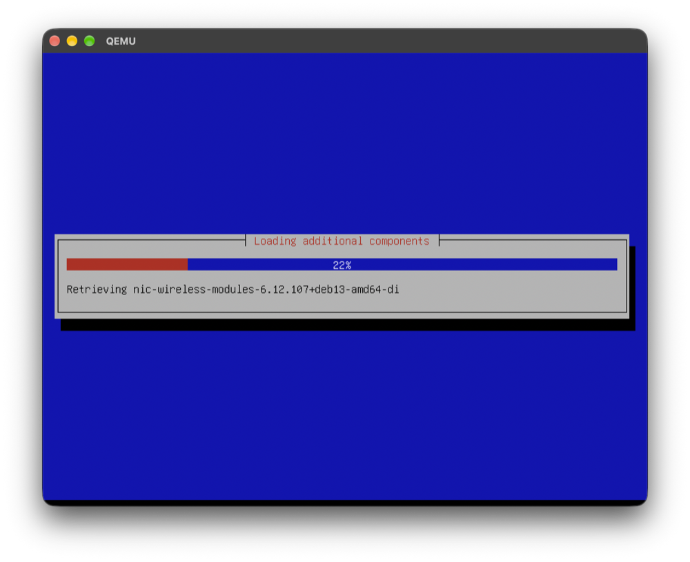
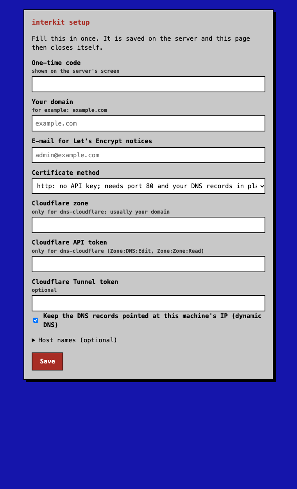
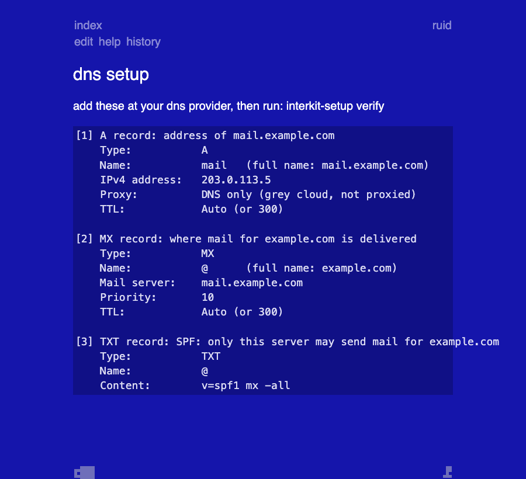
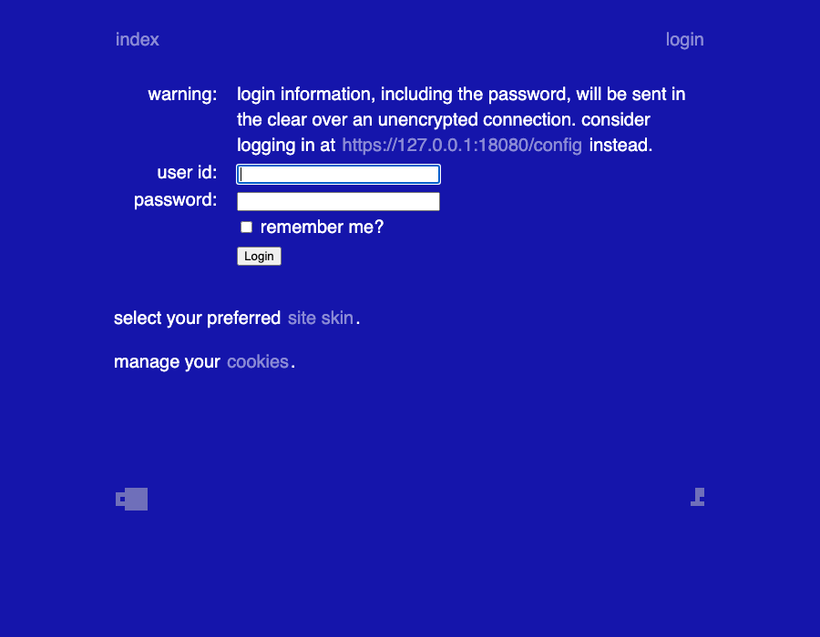

# interkit

Debian-based distro built with live-build (Debian trixie, XFCE, installable ISO).

## Screenshots

The text installer (default Debian blue theme, on the screen console):

`interkit-setup web-ui`: enter the domain and API keys from another computer's browser (one-time code, HTTPS):

The Fossil admin web UI with the interkit skin (blue background, white text), showing the generated "DNS setup" page
(sample data, rendered on a development machine), and the login page on the real image (booted in QEMU):

## Local build (inside a Debian VM, e.g. UTM)
    sudo ./build.sh                 # host arch
    sudo ARCH=amd64 ./build.sh      # target arch (needs native/emulated amd64 host)
ISO + sha256 land in `out/`.

## CI
`.github/workflows/build.yml` builds amd64 and arm64 natively in a matrix.
Run it from the Actions tab, or push a `v*` tag to also publish a release.
To add an arch: add a matrix entry and a `case` in `build.sh`.

## Customize
- `config/package-lists/*.list.chroot` – packages
- `config/includes.chroot/` – files copied into the image
- `config/hooks/normal/` – scripts run in the chroot

## Docs
- `docs/setup.md` - `interkit-setup`: Cloudflare, DERP, XMPP, mail with TLS from sing-box ACME
- `docs/time-sync.md` - system clock (timesyncd) and sing-box NTP / `write_to_system`
- `branding/README.md` - logos and where they are used
